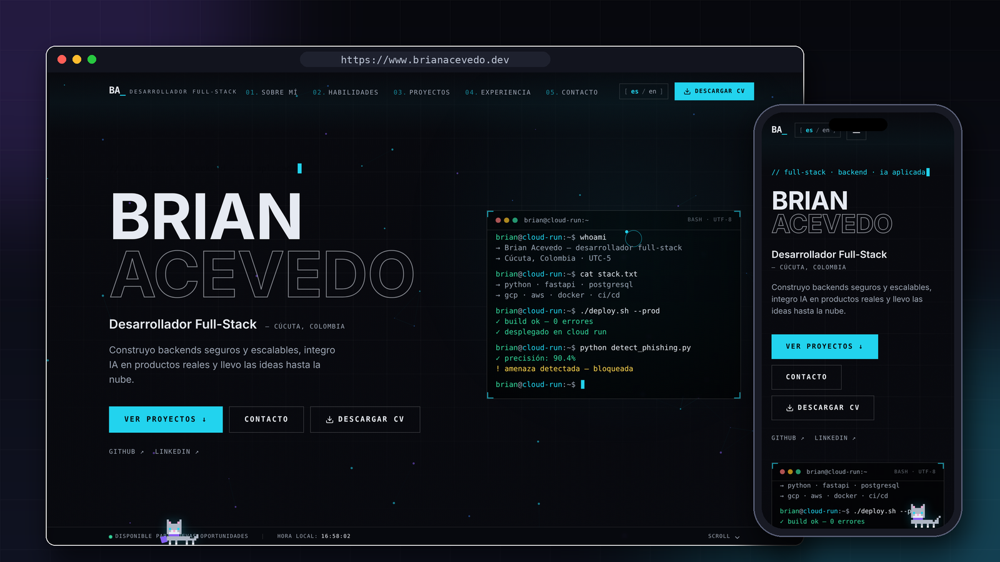
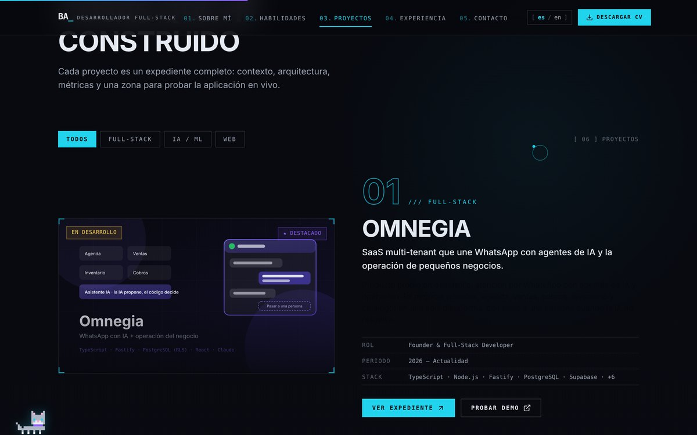
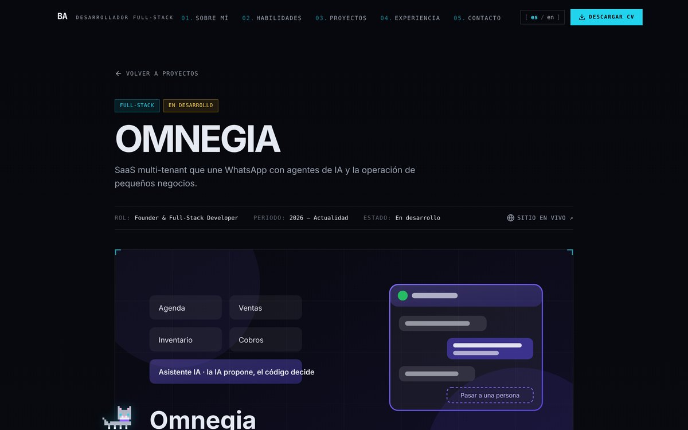

# Hola, soy Brian Acevedo 👋

**Desarrollador Full-Stack · Backend · IA aplicada** — Cúcuta, Colombia

Estudiante de 9.º semestre de Ingeniería de Sistemas (Universidad de Pamplona) y aprendiz del tecnólogo en Análisis y Desarrollo de Software del SENA. Construyo y despliego productos completos: backend, bases de datos, IA aplicada y frontend. Me interesa el backend seguro y la IA que se puede auditar: *la IA propone, el código decide, el humano corrige*.

🔭 Busco empleo, prácticas o proyectos **remotos**.

---

## 🌐 Mi portafolio

  
  

Next.js · TypeScript · Tailwind CSS · Framer Motion · bilingüe (ES/EN) · cada proyecto con su expediente y demo en vivo

<table>
  <tr>
    <td width="50%"></td>
    <td width="50%"></td>
  </tr>
  <tr>
    <td align="center">Proyectos con filtros por categoría</td>
    <td align="center">Expediente de cada proyecto: rol, stack y demo</td>
  </tr>
</table>

---

## 🧩 Proyectos destacados

| Proyecto | Qué es | Stack |
|---|---|---|
| **[Omnegia](https://omnegia.brianacevedo.dev)** · 2026 – hoy | SaaS multi-tenant para pequeños negocios: atención por WhatsApp con agentes de IA + ventas, cobros, inventario y agenda, con paso a una persona cuando la IA no resuelve. Aislamiento entre empresas en tres capas (filtro por tenant, Row Level Security y claves foráneas compuestas), agentes con nivel de riesgo por acción y 478 pruebas automatizadas en CI. | Node.js · Fastify · TypeScript · PostgreSQL · React · Vitest · Playwright |
| **SecurityBot – WA** · 2025 | Detección de fraude y phishing en WhatsApp. Clasificador híbrido SVM + IA con más del 90 % de precisión, reentrenamiento con RLHF y OCR para capturas manipuladas. | Python · FastAPI · Google Cloud Run · Cloud SQL · Docker · scikit-learn |
| **Uniplanner** · 2025 – hoy | Plataforma académica de planeación universitaria: pensum, matrícula, horarios y calificaciones, con lógica en base de datos y workers asíncronos para IA, PDFs y notificaciones. | FastAPI · SQLAlchemy · PostgreSQL · JWT |
| **[Traductor LSC](https://traductor.brianacevedo.dev)** · 2026 | Intérprete de Lengua de Señas Colombiana en tiempo real: MediaPipe detecta las manos y un LLM construye frases en español. | Python · MediaPipe · OpenCV · LLM |
| **[Lions Gym](https://lionsgym.brianacevedo.dev)** · 2025 – 2026 | Gestión de gimnasios: membresías, reservas de clases, pagos y control de acceso por QR. | Java · Spring Boot · Spring Security · PostgreSQL |
| **[MediAlert](https://github.com/imBriann/MediAlert)** | Sistema de recordatorios médicos: alertas de medicamentos para pacientes, panel administrativo de usuarios y medicamentos, reportes y auditoría. | Python · Flask · PostgreSQL (PL/pgSQL) · JavaScript |
| **[Cineko](https://cineko.brianacevedo.dev)** · 2024 | Mi primer proyecto web: cartelera, confitería, membresías y compra de entradas. | Python · Flask · SQLite |

---

## 🛠️ Tecnologías

| Área | Herramientas |
|---|---|
| Lenguajes | Python, TypeScript, JavaScript, Java, SQL |
| Backend | FastAPI, Node.js, Fastify, Spring Boot, Flask, APIs REST, JWT |
| Bases de datos | PostgreSQL (funciones, vistas, triggers, RLS), Supabase, SQLite |
| IA aplicada | Agentes con LLM y herramientas, scikit-learn, RLHF, MediaPipe, OpenCV, OCR |
| Frontend | React, Vite, Next.js, Tailwind CSS |
| Nube y DevOps | Google Cloud (Cloud Run, Cloud SQL, Cloud Build), Render, Docker, GitHub Actions |
| Calidad | Vitest, Playwright, Git con ramas y pull requests |

---

## 📈 GitHub Stats

---

## 🌱 Fuera del código

- Dicto un curso de IA de 60 horas para personal administrativo en la Biblioteca Pública Julio Pérez Ferrero (Cúcuta).
- Integrante del Comité Alertas Tempranas de Ingeniería de Sistemas: hice la página de seguimiento en vivo de las Olimpiadas 2026-2.
